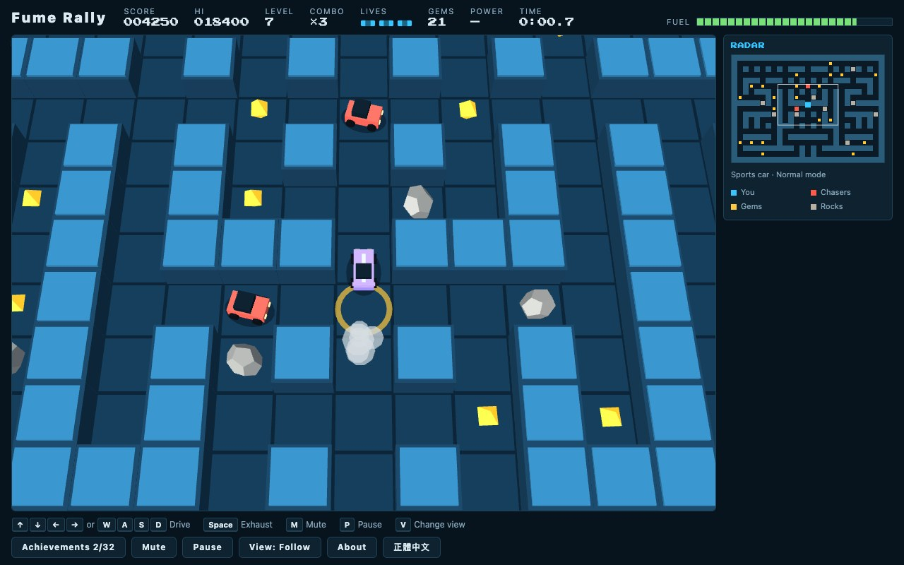

# Fume Rally · 廢氣拉力賽

[](https://github.com/wongwt/FumeRally/actions/workflows/ci.yml)
[](https://github.com/wongwt/FumeRally/releases)
[](LICENSE)


A retro maze-rally arcade game for the browser, built with Three.js and TypeScript.
Collect every gem, outrun the red chasers, drop a cloud of exhaust to freeze them, and mind the rocks and
your fuel gauge. It plays on desktop (keyboard) and on phones and tablets (touch), in Traditional Chinese
or English.



> Inspired by the classic arcade game Rally-X. Not affiliated with or endorsed by Bandai Namco.
> All graphics and sounds are original: the 3D scenes are built from code and the sound effects are
> synthesised at runtime.

## Play

- **Download and double-click.** Each [release](https://github.com/wongwt/FumeRally/releases) includes
  `fume-rally-vX.Y.Z.html`, one self-contained file. No install, no server, no internet connection needed.
- **Online:** <https://wongwt.github.io/FumeRally/> (once GitHub Pages is enabled for the repository).
- **From source:** see [Development](#development).

It needs a browser with WebGL. It is developed and tested mostly in Chromium; recent Safari and Firefox
should work too but get less testing, so please report anything odd.

## How to play

Your car drives itself. You choose where it turns. Collect **all the gems** to clear the stage, and don't
run out of fuel, hit a rock or get caught.

|                                       | Keyboard                                                                                                   | Touch                               |
| ------------------------------------- | ---------------------------------------------------------------------------------------------------------- | ----------------------------------- |
| Steer                                 | <kbd>↑</kbd> <kbd>↓</kbd> <kbd>←</kbd> <kbd>→</kbd> or <kbd>W</kbd> <kbd>A</kbd> <kbd>S</kbd> <kbd>D</kbd> | on-screen pad, or swipe on the maze |
| Drop exhaust                          | hold <kbd>Space</kbd>                                                                                      | **Smoke** button                    |
| Start / resume                        | <kbd>Space</kbd> or <kbd>Enter</kbd>                                                                       | tap the screen                      |
| Pause                                 | <kbd>P</kbd> or <kbd>Esc</kbd>                                                                             | Pause button                        |
| Change view                           | <kbd>V</kbd>                                                                                               | View button                         |
| Mute                                  | <kbd>M</kbd>                                                                                               | Mute button                         |
| Pick start stage / car (title screen) | <kbd>↑</kbd> <kbd>↓</kbd> / <kbd>←</kbd> <kbd>→</kbd>                                                      | swipe up-down / left-right          |

**The rules**

- **Fuel** drains all the time. Every gem refills a little. Run dry and you lose a car. You have three.
- **Gems** score 100 × your **combo**. Grab them within six seconds of each other to climb from ×1 to ×5.
- **Red chasers** leave their corners one by one and hunt you through the maze. They get faster and more
  numerous as the stages go up, and come in three personalities: direct, ambusher and erratic.
- **Exhaust** costs a little fuel. A fresh cloud freezes any chaser that touches it for three seconds,
  and a frozen chaser is harmless.
- **Rocks** are deadly. Chasers path around them.
- **Rainbow gems** make you invincible for seven seconds: smash rocks, knock chasers back to their corners.
- **Bonus stage** after every third stage: 30 seconds, no chasers, no rocks, grab as many gems as you can.
- Clearing a stage pays a **fuel bonus**. The stage number and score climb until you run out of cars.

**Cars** unlock as you clear stages (in any mode):

| Car         | Unlocks  | Special                                  |
| ----------- | -------- | ---------------------------------------- |
| Sedan       | start    | balanced                                 |
| Sports car  | stage 5  | fast but thirsty                         |
| Armored car | stage 10 | absorbs one hit per life                 |
| Off-roader  | stage 15 | crushes rocks without damage             |
| Tanker      | stage 20 | much better fuel economy                 |
| Scout       | stage 25 | sees further                             |
| Police car  | stage 30 | its siren stuns nearby chasers every 8 s |
| Motorcycle  | stage 35 | fastest, no protection                   |

**Challenges.** Normal mode uses fixed maps and lets you restart from any stage you have cleared. **Daily**
mode uses a code that changes every day, and **Code** mode lets you type any code (or roll a random one):
the same code always makes the same maps, so you can race friends on identical stages. Each code has its
own leaderboard. Your fastest flawless clear of each stage is saved as a **ghost car** that you can race.

There are **32 achievements** to collect: seven stage trophies and 25 for everything from your first
crash to a ten-thousand-point run.

## Features

- Seeded, symmetric mazes that start small and open and grow twistier with the level; the same level or code always plays the same.
- Eight cars with their own 3D models and abilities, and 32 achievements.
- Daily challenge, shareable level codes, per-board leaderboards, flawless best times and ghost replay.
- Full-map radar, follow and full-map cameras, screen shake (off with reduced-motion), floating score pop-ups.
- Synthesised sound effects (Web Audio), mutable.
- Works offline. All progress is saved locally in your browser; the game makes no network requests and
  collects nothing.
- Responsive layout, touch controls over the playfield, screen-reader announcements, translated labels and
  recovery if the browser takes the GPU away.

## Development

Requires **Node.js 22+**.

```sh
npm install
npm run dev        # local dev server with hot reload (shows a DEV bar: jump to a stage, unlock cars)
npm test           # unit tests (Vitest)
npm run typecheck  # TypeScript
npm run lint       # ESLint
npm run format     # Prettier
npm run build      # produces dist/index.html, the single self-contained playable file
```

The build output is one HTML file with all code, styles and the pixel font inlined. It runs by
double-clicking it.

```
docs/       architecture notes and the screenshot
src/
  audio/    synthesised sound effects and the mute setting
  config/   constants, car definitions, achievement definitions, About credits
  core/     pure, tested logic (RNG, maze generation, pathfinding, challenge codes, events)
  game/     glue: the game loop, progress, achievements, challenge selection
  i18n/     message tables (zh-TW, en)
  input/    keyboard, swipe and on-screen pad → one wanted direction
  render/   Three.js scene, meshes, car models, effects and cameras
  sim/      the game rules: movement, chasers, fuel, gems, power-ups, phases (no DOM, no Three.js)
  storage/  versioned records, ghosts and preferences in localStorage
  ui/       HUD, banners, panels, dialogs, icons
tests/      unit tests
```

New here? Read [docs/ARCHITECTURE.md](docs/ARCHITECTURE.md) and [CONTRIBUTING.md](CONTRIBUTING.md).

## Releases

Push a tag such as `v0.1.0`: the [Release workflow](.github/workflows/release.yml) runs the checks, builds the
single file and attaches it to a GitHub Release. See [CHANGELOG.md](CHANGELOG.md) for what changed.

## License

[MIT](LICENSE) © Wei-Te Wong. The playable build also bundles [three.js](https://threejs.org) (MIT) and the
[Press Start 2P](https://fonts.google.com/specimen/Press+Start+2P) font (SIL OFL 1.1); their notices are in
[THIRD_PARTY_NOTICES.md](THIRD_PARTY_NOTICES.md) and embedded in the built file.
